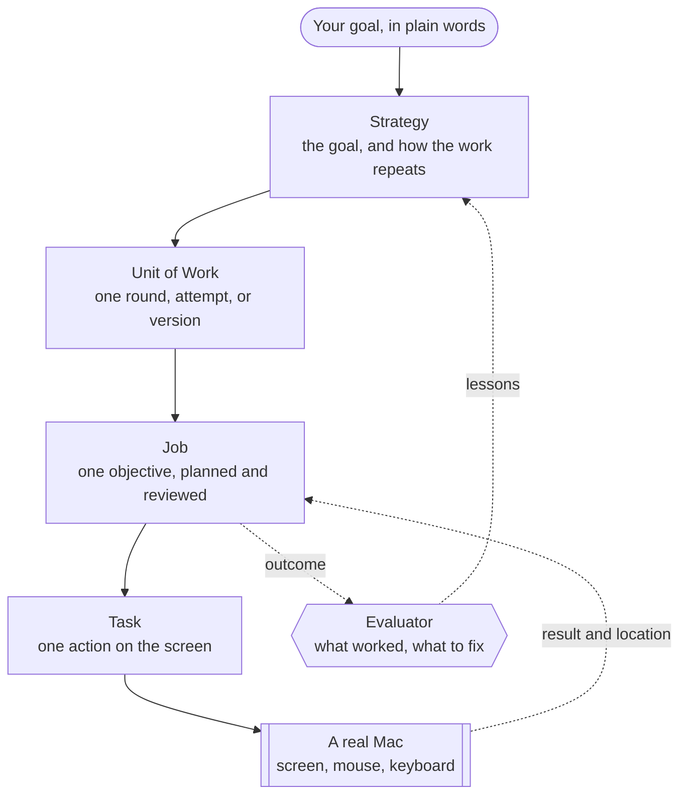

### Give it a goal. It plans, acts on a real computer, and self-improves with every round.


          


**[Website](https://baraasoft.github.io/ahe-ai-coworker/)** · **[Demo](#demo)** · **[Quick start](#quick-start)** · **[How it works](#how-it-works)** · **[The dashboard](#the-dashboard)** · **[Safety](#safety)** · **[Project structure](#Project-structure)**

## What AHE is

It is an **AI co-worker**. It takes ownership of a goal, and it carries the work for days or weeks.

AHE has its own internal governance and orchestration system. The system breaks a goal into levels of work,
so many AI agents can work as one co-worker and share what they learn. AHE does each piece on a real Mac with
the mouse and the keyboard, like a person. It self-improves. It learns from its own work: it keeps what worked,
and it fixes what did not. It recovers from failures, gets past routine obstacles, and builds a knowledge base
as it goes.

You do not prompt it step by step. You brief it once, like a colleague. Then you watch it work.

> [!NOTE]
> We built AHE for the Meta Hackathon. **Meta Muse can run every layer**: the planning, the judgement, and the
> hands-on work on screen. One Meta API key is enough to run all of it.

## Demo

One run, from start to end. AHE plans a book launch, designs the graphic in Canva, marks its own work, and posts
it on X. The dashboard is on the left, and the Mac screen is on the right. Both are sped up. This run used
Claude on every layer. Each layer can also run on Muse.


No YouTube? [Play the demo on GitHub](https://github.com/user-attachments/assets/ca1138b0-b9ae-4669-8b00-6606a39df38c).

## A co-worker, not an assistant

An assistant waits for your next prompt. A co-worker owns a piece of the work, and its judgement grows over time.

| | A typical agent | AHE |
| --- | --- | --- |
| Scope | One prompt, one loop | One goal that runs for days or weeks |
| Memory of the work | The chat window | A knowledge base of every round, Job, Task, and lesson |
| Quality | It stops when the steps end | It learns from its own work and tries a better idea |
| Evidence | It guesses | It opens the real post, file, or design first |
| When stuck | It fails or loops | It recovers, waits, or asks you one clear question |
| Control | Kill the process | Pause, resume, or run again from a dashboard |

## What it can do

**Governance, not just execution.** AHE splits a goal into four levels: Strategy, Unit of Work, Job, and Task.
Each level plans on its own and reads only a short summary of the level below. This keeps long autonomy cheap
and clear, even after hundreds of steps. Many agents work as one co-worker and share what they learn.

**Self-improvement is the core.** After every round, an evaluator reviews each Job against real evidence: the
actual output and the actual numbers, opened on the real screen. When the evidence is missing, AHE sends a real
Job to get it, for example to open the analytics dashboard and read this week's sign-ups. The lessons feed the
next round: keep what worked, fix what did not. A new run of the same goal reads the last three runs, and AHE
finds similar past work by meaning. In [our benchmark](eval/), it never ranked weak work above strong work.

**Any app on the Mac.** AHE operates macOS with the mouse, the keyboard, and screenshots, like a person. It works  
in Canva, spreadsheets, the browser, or anything else on the screen. It recovers on its own from popups, broken pages,  
rate limits, and crashes.

**Safety by design.** Hard walls block system settings, purchases, and account changes. AHE reports a CAPTCHA
and never solves it. It types a login only on that login's own site.

## The dashboard

The dashboard is where you brief your co-worker and watch it work. It is dark, glassy, and live.

The screenshots below use sample data. The Canva graphic inside the Job panel is real: AHE designed it in an earlier run.

### Watch the work, live


The **Monitor** page draws the whole run as a live board in four lanes: Strategy, Units of Work, Jobs, and
Tasks. The green card runs now, and a light flows along its line. The bar on top sums up the run: the rounds,
the Jobs at work, the Tasks done, and the best result. The board updates every 2 seconds.

AHE uses the Mac's own screen, so watch from your phone. `pnpm dev:start` prints the Wi-Fi address and a QR code.

### See what it made, and what it learned


Click any card to open its details. A Job shows the final screen of its work, the objective, the outcome, and  
the agent's own review: what worked, and what to fix. Click the screenshot to see it full screen.

### Brief it like a colleague


1. Open **Create strategy**.
2. Write a short name and the outcome you want, one step per line.
3. Choose how the work repeats: one-off, multi-version, or continuous.
4. Click **Launch**. The side panel shows each launch step, and the dashboard opens Monitor.

### Every run in one place


A Strategy is a reusable goal. Each Workflow is one run of it: running, paused, or done. **WorkHub** lists every
run. Pause one, resume it, or open it in Monitor. To start a goal again from round 1, pick it in **Run again**.
The fresh run still learns from the earlier runs.  
One Mac runs one Workflow at a time, so AHE pauses the current run first.

## How it works

### Four levels of work



Each level reads only a short summary of the level below it. The Strategy planner never sees a Task. The Task
planner never sees a screenshot. Only the final screen of a visual Task goes up, to the Job reviewer and the
evaluator. This keeps long autonomy cheap, and the thread stays clear after hundreds of steps.

### The loop that makes it better

1. **Plan.** The Strategy planner researches the brief and writes the Jobs of the next round. Each round names

   the idea it tests, and why.
2. **Act.** For each Task, the Task planner writes one step. The hands-on agent does the work on screen and

   reports back. The planner reads the result and writes the next step, until the Task is done.
3. **Review.** The Job reviewer checks every finished Task. It continues, revises the plan, or closes the Job.
4. **Reflect.** When a round ends, the evaluator reviews each Job. It writes what worked and what to fix, as

   advice for its own planner.
5. **Self-improve.** The next round keeps what worked and fixes what did not. When the stop rule says the goal

   is met, the run is done.

The orchestrator moves every run forward once a minute. A pass decides when a round opens, when it is reviewed,
and which Jobs may start.

### Thinking and doing are separate

The **reasoning layer** plans and reviews. It never touches the screen. The **execution layer** sees the screen,  
and clicks and types. It gets one plain instruction, the scope of its Task, and nothing else.  
Each level picks its own model, so a fast model can plan every step and a strong model can review.

## Quick start

### What you need

- **A Mac with macOS.** AHE controls this Mac's own screen. Use a Mac that the agent can have while it works.
- **Docker Desktop**
- **Node.js 22** and **pnpm 10**. Run `corepack enable` to get pnpm.
- **Xcode Command Line Tools**, for the native mouse and keyboard module. Run `xcode-select --install`.
- **A Meta API key** for Muse. An Anthropic key also works, if you want Claude.

### Run it

1. Clone the repository.
   ```bash
    git clone https://github.com/BaraaSoft/ahe-ai-coworker.git
    cd ahe-ai-coworker
    corepack enable
   ```
2. Run the quick start. Paste your Meta API key when it asks.
   ```bash
    pnpm quickstart
   ```

    It checks your Mac, Node.js, pnpm, and Docker, and installs the packages. It writes `.env` with Muse on every
    layer, starts Postgres and Redis in Docker, and applies the migrations. Then it checks the screen
    permissions and launches AHE.
3. Open [http://localhost:5173](http://localhost:5173), and create your first strategy.

The first time, macOS asks you to allow your terminal app in **Accessibility** and **Screen Recording**. Allow
both, restart the terminal, and run `pnpm quickstart` again. Each run skips the work that is already done.

<details>
<summary><b>Run each step by hand</b></summary>

<br/>


1. Install the packages, and create your `.env` file from the example.
   ```bash
    pnpm install
    cp .env.example .env
   ```
2. Open `.env`, and add your Meta key. Create the key in the

   [Meta Model API dashboard](https://dev.meta.ai/docs/authentication). Then set every layer to Muse.
   > **Tip:** For the most reliable screen control, keep Muse on the reasoning layers, and run execution on
   > Claude. Set `EXECUTION_PROVIDER=anthropic`, and add your `ANTHROPIC_API_KEY`.
3. Start the database and the queue. Leave this terminal open.
   ```bash
    pnpm compose:up
   ```

    This starts Postgres with pgvector on port 5433 and Redis on port 6380. Then it applies every migration.
4. In a new terminal, give the agent the screen.
   ```bash
    pnpm --filter @ahe/execution check:desktop
   ```

    The check saves one screenshot, and it sends no mouse or keyboard input.
5. Launch AHE.
   ```bash
    pnpm dev:start
   ```

    This starts the backend on port 3088 and the dashboard on port 5173. The first start also downloads a small
    embedding model, one time.

</details>


> [!WARNING]
> AHE uses the real mouse and keyboard. Do not use the Mac while a Task runs. Pause the run from the dashboard
> first, and the agent stops after its current step.

### Choose the models

Each layer reads its own setting in `.env`. Set a provider to `muse` or `anthropic`, and mix them if you like.
The Anthropic provider uses `ANTHROPIC_API_KEY`.

| Setting | What it runs | Muse default |
| --- | --- | --- |
| `REASONING_STRATEGY_PROVIDER` | Plans each round, and reviews the work | `muse-wonder-1.0` |
| `REASONING_JOB_PROVIDER` | Plans and reviews the Tasks of each Job | `muse-wonder-1.0` |
| `REASONING_TASK_PROVIDER` | Plans every step, the hot path | `muse-wonder-1.0` |
| `EXECUTION_PROVIDER` | Sees the screen, clicks, and types | `muse-wonder-1.0` |

Each provider has a matching `_MODEL_ID` setting. We suggest `muse-wonder-1.0`

### Useful commands

| Command | What it does |
| --- | --- |
| `pnpm dev:start` | Starts the backend and the dashboard together |
| `pnpm compose:down` | Stops Postgres and Redis |
| `pnpm dev:reset` | Clears every run, queue, and screenshot, and keeps your Strategies. Stop the backend first |
| `pnpm test` | Runs the unit tests of every package |
| `pnpm test:integration` | Runs the database tests against a real Postgres |
| `pnpm test:smoke` | Calls the live Meta Model API with both Muse models. Needs `META_API_KEY` |
| `pnpm typecheck` | Type-checks every package |

The integration tests need an `ahe_test` database. Create it once:

```bash
docker compose -f compose.yaml exec postgres createdb -U ahe ahe_test
```

The backend also serves two admin tools: the API docs at [localhost:3088/admin/docs](http://localhost:3088/admin/docs)
and the queues at [localhost:3088/admin/queues](http://localhost:3088/admin/queues). The login comes from
`ADMIN_USERNAME` and `ADMIN_PASSWORD` in `.env`.

## Safety

The safety rules live in the structure, not in a filter at the end.

- **The screen is untrusted.** Only the instruction counts. AHE never follows text it finds on a web page, in a
message, or in a notification.
- **Hard walls.** It never opens Terminal, changes system settings, makes purchases, accepts terms, creates
accounts, or changes passwords.
- **Gates it never passes.** A CAPTCHA, a verification code, or an account warning stops the Task. AHE reports
it, and a planner decides what happens next.
- **Owner escalation.** Some decisions belong to you, such as a login it does not have. AHE parks the Task and  
asks you. (coming soon)
- **Guardrails on effort.** Three failed Tasks in a row close a Job. A Job plans around a budget of 20 Tasks,
and it stops at a hard limit of 60.
- **Credentials stay where they belong.** AHE types a login only on its own site, and never repeats it in a
report. It also removes tokens and tracking codes from every saved link.
- **One machine, one run.** A new run on the Mac pauses the current one first, so two runs never fight for
the mouse.

## Project structure

```text
packages/
├── agent-core/    shared domain types and contracts
├── backend/       runs on your Mac (localhost:3088): the API, the reasoning layer, the queues, and the orchestrator
├── execution/     the hands-on agent: the macOS driver, and the Muse and Claude providers
├── migrations/    migrations, applied by Docker on start
└── web-ui/        the ui dashboard (localhost:5173)
```

<details>
<summary><b>Engineering notes</b>: the rules we hold to, and the design documents</summary>

<br/>


- **The database is the source of truth.** Queues only carry work. A message that arrives late, twice, or out of
order changes nothing.
- **Every state change checks the state it expects.** A Task delivered twice runs once.
- **Reasoning is stateless.** Each reasoner reads its inputs from the database, decides, and returns JSON.
- **Tests at every level.** 479 automated tests: 277 backend unit tests, 69 database integration tests, and
133 execution tests. An end-to-end suite also runs the real desktop with a real model.
- **A benchmark for the self-review.** [`eval/`](eval/) runs the real evaluator on pairs of strong and weak
work, on screenshots of real visual work, and on Jobs that need live evidence. It reports ranking accuracy, evidence requests, valid output,
and latency.

Read the design documents for the details:

| Document | What it explains |
| --- | --- |
| [Orchestrator](packages/backend/src/orchestrator/README.md) | Runs, work types, the scheduling pass, and when work is reviewed |
| [Governance processors](packages/backend/src/governance/processors/README.md) | How Jobs and Tasks move, wait, fail, and recover |
| [Reasoning](packages/backend/src/reasoning/README.md) | Every planner and the evaluator, their inputs, and their prompts |
| [Execution](packages/execution/README.md) | The hands-on loop, the macOS driver, and the providers |

</details>


<details>
<summary><b>Built during Meta Global AI Hackathon 2026</b>: every feature, day by day</summary>

<br/>


| Day | What AHE can now do |
| --- | --- |
| 4 Nov | Build on what earlier Jobs made, report what it did when a step runs out of time, and welcome visitors on a one-page website |
| 3 Nov | Prove its self-review with a benchmark, run CI on every package, start with one command, and show each Job's work |
| 2 Nov | Use the computer with Meta Muse, run and pause many runs in WorkHub, launch a Strategy from a form, and show the work live |
| 1 Nov | Think with Meta Muse, research the brief on the web, aim for creative design, and show a dashboard |
| 31 Oct | Work with skills, ask the owner when it is stuck, and set up its own database |
| 30 Oct | Work step by step on screen, and run ongoing, one-off, and multi-version goals |
| 28 Oct | Judge work it has to see, and find out what good work looks like |
| 27 Oct | Review its own work and learn from it, and record where each Task was done |

Read the full log, with an example for each feature: [docs/hackathon-features-log.md](docs/hackathon-features-log.md).

</details>


## Roadmap

- Connect with HumanExperiences.IO so HumanExperiences users can operate their AHE from there.
- Run several Macs at once, one Workflow on each.
- Add more skills, for video editing and CAD engineering design.
- Let the owner operate AHE from Slack workspaces and WhatsApp.

## License

AHE is open source under the [GNU Affero General Public License v3.0](LICENSE).

Built by [Baraa](https://github.com/BaraaSoft) Powered by Meta Muse, 2026.

<details>
<summary><b>Troubleshooting guide</b>: fixes for common setup errors</summary>

<br/>

#### "AHE needs Node.js 22 or newer"

The scripts run with the Node that pnpm uses, and that can differ from the `node` in your terminal. Compare
the two:

```bash
node -v             # the Node in your terminal
pnpm exec node -v   # the Node your scripts get
```

If either one is below 22, switch to Node 22 with the tool you already use, then get pnpm again on top of it:

| You use | Switch to Node 22 |
| --- | --- |
| The installer from [nodejs.org](https://nodejs.org) | Install the 22 LTS release |
| Homebrew | `brew install node@22 && brew link --overwrite --force node@22` |
| nvm | `nvm install 22 && nvm alias default 22` |
| fnm | `fnm install 22 && fnm default 22` |
| Volta | `volta install node@22` |

```bash
corepack enable                          # gives you the pnpm version in package.json (10.4.1)
corepack prepare pnpm@10.4.1 --activate
```

With Volta, run `volta install pnpm@10.4.1` instead. Volta keeps each tool on the Node it was installed
with, so pnpm stays on the old Node until you reinstall it.

Open a new terminal, and check that `pnpm exec node -v` shows 22 and `pnpm -v` shows 10.4.1. If it still
shows an old version, run `which -a pnpm`. A pnpm installed earlier with `npm install -g pnpm` or Homebrew
may come first on your `PATH`. Remove it with `npm uninstall -g pnpm` or `brew uninstall pnpm`.

#### "Screen Recording: MISSING" or "Accessibility (input): MISSING"

macOS gives these permissions to the app that runs the terminal, not to the terminal tab. In the Cursor or
VS Code terminal, that app is Cursor or VS Code. Otherwise it is Terminal or iTerm.

1. Open **System Settings › Privacy & Security**.
2. Turn the app on in **Accessibility** and in **Screen & System Audio Recording**. If it is not in the list,
   add it with **+**.
3. Quit the app with Cmd+Q, and open it again. A new tab is not enough.
4. Run `pnpm quickstart` again.

#### "Cannot find module '../bin/napi-v6/darwin/x64/onnxruntime_binding.node'"

This happens on Intel Macs. `onnxruntime-node` 1.24 and later ship no Intel Mac binary, so the local
embedding model cannot load. The root `package.json` pins the last release that has one:

```json
"pnpm": { "overrides": { "onnxruntime-node": "1.23.2" } }
```

If you still see the error, reinstall so the pin takes effect: `pnpm install`. Then check that
`node_modules/.pnpm/onnxruntime-node@1.23.2/node_modules/onnxruntime-node/bin/napi-v6/darwin/x64` exists.

</details>
